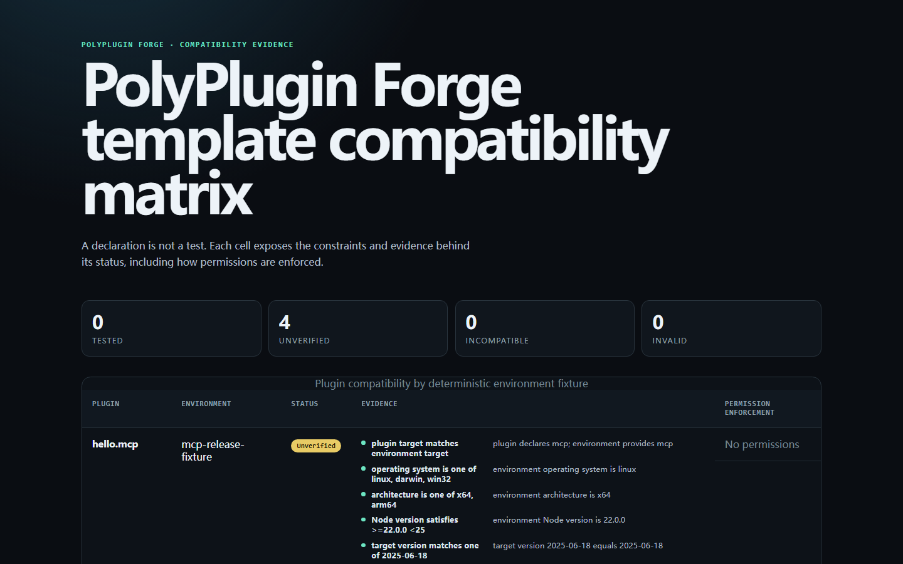

# PolyPlugin Forge

[English](README.md)

[](https://github.com/KanadeK/polyplugin-forge/actions/workflows/ci.yml)
[](https://github.com/KanadeK/polyplugin-forge/actions/workflows/security.yml)
[](https://github.com/KanadeK/polyplugin-forge/releases/latest)
[](LICENSE)

一份插件描述，四种真实目标，发布前就能审计的证据。

插件团队往往要用互不兼容的格式重复描述相同的能力、权限、数据流、运行时限制与测试。PolyPlugin
Forge 把这些意图集中在一份可审计的 `plugin.yaml` 中，再生成并检查 MCP、VS
Code、Chrome Manifest V3 与 OpenAPI webhook 项目。



**当前版本：v0.1.0**

- 为四种插件目标生成完整、可离线测试的项目。
- 生成原生 manifest，执行发布前安全检查，并输出区分证据状态的兼容矩阵。
- 通过三方比较升级内置模板，绝不静默覆盖用户修改。

直接安装经过发布门禁验证的 GitHub Release 包：

```bash
npm install --global https://github.com/KanadeK/polyplugin-forge/releases/download/v0.1.0/polyplugin-forge-0.1.0-npm.tgz
polyplugin --version
```

CLI 采用本地优先设计：没有遥测、分析、凭据存储或云同步；核心校验和生成不需要联网。生成代码仍会使用自身
`plugin.yaml` 中声明的权限，发布前应审查权限和原生 manifest。

## 真实输入 → 真实输出

给定这份统一输入：

```yaml
metadata:
  id: hello.mcp
  version: 0.1.0
  package: hello-mcp
target:
  type: mcp
  protocolVersion: "2025-06-18"
  transport: stdio
privacy:
  notice: docs/PRIVACY.md
  collectsPersonalData: false
  telemetry: false
```

执行：

```bash
polyplugin manifest generate examples/mcp-hello
polyplugin manifest lint examples/mcp-hello
```

仓库内示例会生成真实的 `server.json`：

```json
{
  "$schema": "https://static.modelcontextprotocol.io/schemas/2025-10-17/server.schema.json",
  "description": "Returns a deterministic greeting over MCP stdio.",
  "name": "hello.mcp",
  "packages": [
    {
      "identifier": "hello-mcp",
      "registryType": "npm",
      "transport": { "type": "stdio" },
      "version": "0.1.0"
    }
  ],
  "version": "0.1.0"
}
```

## 功能

- 带大小限制的安全 YAML 解析器，以及覆盖身份、运行时、能力、权限、数据流、隐私、兼容性和测试的类型化 schema。
- 语义检查可发现未声明或未使用的权限、缺失的隐私声明、缺失的测试引用、无效入口与不安全项目路径。
- 确定性生成并校验四种原生 manifest：
  - MCP `server.json`
  - VS Code `package.json` contributions
  - Chrome Manifest V3 `manifest.json`
  - OpenAPI 3.1 `openapi.json`
- 发布前检查覆盖静态有效性、疑似密钥、原生 manifest、构建、测试与构建后入口。
- HTML、Markdown、JSON 兼容矩阵，明确区分**已测试**、**未验证**、**不兼容**和**无效**。
- 三方比较的非破坏模板升级，冲突材料明确写入 `.polyplugin/conflicts/`。
- 人类可读与 JSON CLI 输出，以及类型化库 API。
- 每种目标都提供版本化的 `1.0.0` 与 `1.1.0` 模板。

## 不做什么

PolyPlugin Forge 不会：

- 代替 MCP、VS Code、Chrome 或 HTTP 运行时；
- 代替用户发布到 npm、扩展商店或生产 webhook 主机；
- 获取或执行任意远程模板；
- 在没有执行证据时把兼容声明说成“已测试”；
- 用最低共同能力模型掩盖权限或数据流差异。

## 架构

```text
plugin.yaml
    │
    ├─ 安全解析 + schema + 语义策略
    │
    ├─ 原生 manifest 生成 ───────> server.json / package.json /
    │                              manifest.json / openapi.json
    ├─ 发布前适配器 ─────────────> 密钥 / 构建 / 测试 / 入口
    ├─ 兼容性求值 ───────────────> HTML / Markdown / JSON 证据
    └─ 模板状态 + 基线 ──────────> 三方升级计划
```

确定性决策位于
`src/core`；文件系统、进程、Git 与浏览器副作用位于适配器之后；命令负责翻译用户意图，报告器只负责序列化结果。架构不变量和目录布局见[架构说明](docs/ARCHITECTURE.md)。

## 安装

### GitHub Release

需要 Node.js `>=22 <25`。

```bash
npm install --global https://github.com/KanadeK/polyplugin-forge/releases/download/v0.1.0/polyplugin-forge-0.1.0-npm.tgz
```

Release 资产包含 npm tarball、四个可直接检查的模板 ZIP、兼容矩阵报告和
`SHA256SUMS.txt`。

### 从源码安装

```bash
git clone https://github.com/KanadeK/polyplugin-forge.git
cd polyplugin-forge
npm ci
npm run build
node dist/cli.js --help
```

仓库内的 workspace 锁文件也支持 `pnpm install --frozen-lockfile`。

## 快速开始

创建一个真实 MCP 项目：

```bash
polyplugin create hello-mcp \
  --template mcp \
  --plugin-id com.example.hello-mcp \
  --name "Hello MCP" \
  --description "Return a deterministic greeting." \
  --package-name hello-mcp

cd hello-mcp
npm ci
npm test
npm run build
polyplugin preflight .
```

同一命令也接受 `vscode`、`chrome` 或 `webhook` 模板。创建操作拒绝写入非空目录。

## 完整工作流

### 审计已有项目

```bash
polyplugin lint ./my-plugin
polyplugin manifest generate ./my-plugin --check
polyplugin manifest lint ./my-plugin
polyplugin preflight ./my-plugin
```

lint、manifest、preflight 和 upgrade 命令都可以添加
`--json`，输出稳定的机器可读诊断。疑似密钥诊断只包含检测器和位置，不包含匹配值。

### 生成兼容报告

```bash
polyplugin matrix \
  examples/mcp-hello \
  examples/vscode-hello \
  examples/chrome-hello \
  examples/webhook-hello \
  --catalog fixtures/compatibility-environments.yaml \
  --out compatibility.html
```

可以使用 `--format json`、`--format md`，也可以通过输出扩展名选择格式。

### 不丢失本地修改地升级

```bash
polyplugin upgrade ./my-plugin --to 1.1.0 --dry-run
polyplugin upgrade ./my-plugin --to 1.1.0
```

确定无歧义的新增，以及用户未改动的模板替换，会一起应用。如果内置模板和用户修改了同一受管理文件，工具不会进行含糊写入。请检查
`.polyplugin/conflicts/` 中的副本，修改当前文件，然后继续：

```bash
polyplugin upgrade ./my-plugin --to 1.1.0 --continue
```

## CLI 与库 API

| 命令                        | 用途                                               |
| --------------------------- | -------------------------------------------------- |
| `create <dir>`              | 把一个内置目标模板渲染到空目录。                   |
| `lint [dir]`                | 解析并语义校验 `plugin.yaml` 及其引用。            |
| `manifest generate [dir]`   | 生成原生 manifest，或使用 `--check` 检查是否最新。 |
| `manifest lint [dir]`       | 根据统一意图校验原生 manifest。                    |
| `preflight [dir]`           | 执行本地发布前安全与完整性门禁。                   |
| `matrix <dirs...>`          | 把兼容证据渲染为 HTML、JSON 或 Markdown。          |
| `upgrade [dir] --to <版本>` | 计划或应用非破坏性的三方模板升级。                 |

所有选项和退出行为见 [CLI 参考](docs/CLI.md)。

包还导出纯领域函数：

```ts
import {
  evaluateCompatibilityMatrix,
  generateAndValidateManifest,
  parsePluginManifest,
  validatePluginDefinition
} from "polyplugin-forge";

const parsed = parsePluginManifest(yamlSource);
if (parsed.value) {
  const diagnostics = validatePluginDefinition(parsed.value);
  const manifest = generateAndValidateManifest(parsed.value);
}
```

## 示例与 fixtures

| 路径                                       | 原生输出        | 有意义的行为                       |
| ------------------------------------------ | --------------- | ---------------------------------- |
| `examples/mcp-hello`                       | `server.json`   | MCP stdio `hello` 工具。           |
| `examples/vscode-hello`                    | `package.json`  | 已注册的 VS Code 问候命令。        |
| `examples/chrome-hello`                    | `manifest.json` | 可访问、状态确定的 MV3 popup。     |
| `examples/webhook-hello`                   | `openapi.json`  | 仅监听 loopback 的 HTTP 问候端点。 |
| `fixtures/compatibility-environments.yaml` | —               | 报告使用的四个显式目标环境。       |

每个模板都包含隐私声明、许可证、测试、构建脚本、构建后入口检查与锁文件。发布门禁会安装、测试并构建 4 种目标 ×
2 个版本的全部组合。

## 测试与可复现性

```bash
npm ci
npm run verify
npm run demo
npm run benchmark
npm run package
npm run release-check
```

`npm run verify`
依次运行格式、lint、类型检查、Vitest 覆盖率、所有模板构建、Playwright
E2E 与生产构建。v0.1.0 本地基线为 79 个 Vitest 测试和 7 个 Playwright 测试；语句、分支、函数、行覆盖率分别为 87.85%、80.78%、94.49%、87.77%。领域核心行覆盖率为 95.10%，分支覆盖率为 88.20%。

确定性基准使用四个仓库内插件和四个仓库内环境。机器、方法和结果见[基准报告](docs/BENCHMARK.md)。

## 隐私与安全

- 没有遥测、分析、云同步或凭据存储。
- YAML 大小、别名、标签与嵌套限制可降低解析器滥用风险。
- 受管理路径拒绝目录穿越、绝对路径和符号链接逃逸。
- 子进程接收参数数组，且不经过命令 shell。
- 疑似密钥诊断和 JSON 升级计划不会回显文件内容或匹配到的凭据。
- webhook 示例只监听 loopback。
- Release 资产会在干净临时目录中安装，并附带 SHA-256 校验值。

威胁模型与信任边界见[隐私与安全](docs/PRIVACY_AND_SECURITY.md)。安全问题请按
[SECURITY.md](SECURITY.md) 私下报告。

## 差异化

一份标注日期的 15 个公开仓库样本显示，单一生态工具和通用模板升级工具都很成熟，但该样本中没有发现同名或高度同构的活跃项目。PolyPlugin
Forge 把四种真实目标模板、一份可审计 manifest、原生 manifest 检查、发布前安全门禁、证据化兼容性与非破坏升级组合起来。这是有边界的抽样比较，不是“全球唯一”声明。详见[相邻项目抽样检索](docs/COMPETITOR_SCAN.md)。

## 路线图

- 基于真实 manifest 反馈，把统一 schema 稳定为 `v1`。
- 在不削弱本地优先设计的前提下，增加可选的商店专用打包适配器。
- 从现有原生 manifest 导入一份可审查的统一草稿。
- 为 Release 资产增加签名来源证明。

## 贡献

请先阅读 [CONTRIBUTING.md](CONTRIBUTING.md)，运行 `npm ci` 与
`npm run verify`，并为可观察行为补充测试。不要添加遥测，也不要静默扩大权限。架构变化应保持安全不变量。

## 常见问题

### 一份 manifest 会让四种目标完全相同吗？

不会。它集中表达共享意图，同时显式保留目标专属约束。每个原生生成器只校验自己负责的目标。

### “兼容”是否表示插件已在该环境中运行？

只有**已测试**单元格带执行证据。只有声明、没有执行时会显示为**未验证**，不会偷偷升级成“已测试”。

### 升级会覆盖我的修改吗？

不会静默覆盖。三方比较会区分旧模板基线、当前用户文件和新模板；歧义会变成供审查的冲突材料。

### 发布前检查会上传源码吗？

不会。preflight 读取本地文件并执行项目声明的本地构建和测试命令。对不受信任的项目，应先审查这些命令。

### 必须发布到 npm registry 吗？

不需要。v0.1.0 通过已验证的 GitHub Release
tarball 和源码仓库分发；生成的模板仍是普通的 npm 兼容 Node 项目。

## 许可证

[MIT](LICENSE) © KanadeK
